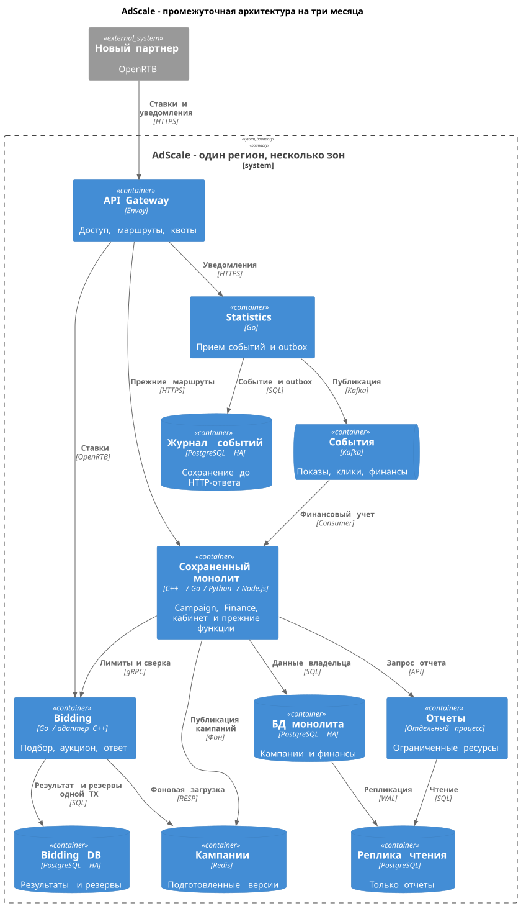
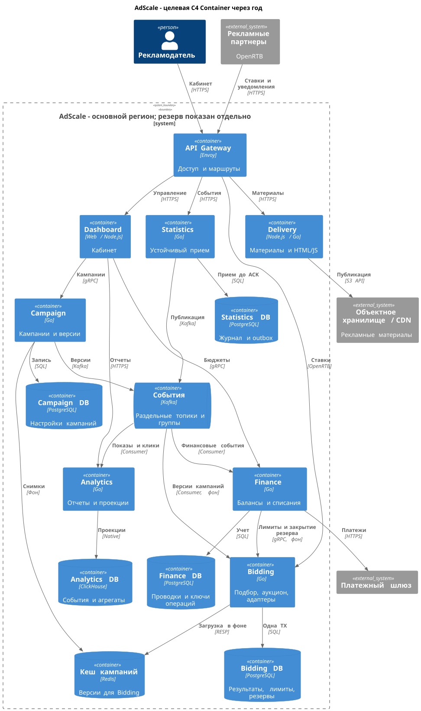

# TO-BE: постепенное выделение сервисов

Выбран Strangler Fig: новые функции постепенно принимают трафик монолита, а работающие части сохраняются. Первыми выделяются Bidding и прием событий, потому что от них зависят задержка торгов и нагрузка на общую БД.

## Через три месяца

[Исходник](diagrams/intermediate.puml)

Минимальный состав:

- Envoy принимает внешние запросы, проверяет доступ и направляет их нужному обработчику
- Go Bidding объединяет подбор кандидатов, аукцион и формирование ответа
- Redis распространяет подготовленные кампании; Bidding держит рабочую копию в памяти
- собственная PostgreSQL Bidding хранит результаты запросов и резервы
- Statistics сохраняет принятые события и отправляет их в Kafka
- существующие отчеты работают отдельным процессом с read replica и ограничением ресурсов

Campaign, Finance и кабинет пока остаются модулями монолита с внутренними API. Адаптер Campaign публикует изменения, Finance выделяет Bidding ограниченный бюджет. Ни один из них не вызывается синхронно для каждой ставки.

Алгоритм C++ сохраняется за локальным адаптером в Bidding. До переноса проверяются безопасность вызовов и совпадение результатов; остальные функции монолита не переписываются ради единого языка.

Первый этап рассчитан на 18 000 RPS, общий P95 до 100 мс и ответ новому партнеру до 80 мс. Конкурирующие отчеты изолируются от торгов; если измерения выявляют ограничение CPU, порядок работ меняется в пользу оптимизации расчета.

## Через год

[Исходник](diagrams/target.puml)

| Сервис | Ответственность | Данные |
|---|---|---|
| Bidding | Подбор, аукцион, ответ и резерв | Результаты запросов и выделенные лимиты |
| Campaign | Кампании, таргетинг, статусы | Кампании и их версии |
| Statistics | Устойчивый прием показов и кликов | Журнал событий |
| Finance | Платежи, балансы, окончательные списания | Финансовый журнал |
| Analytics | Проекции и отчеты | ClickHouse |
| Delivery | Материалы и HTML/JS | Объектное хранилище и CDN |
| Dashboard | Интерфейс рекламодателя | Обращается к API владельцев |

Новые серверные компоненты пишутся на Go. Сервисы не читают чужие таблицы: управление идет через API, события - через Kafka. Подбор и аукцион остаются одним Bidding, чтобы не добавлять сетевые вызовы внутри 80 мс.

Годовая схема рассчитана на 50 000 RPS и несколько рекламных платформ. Приложения развернуты в основном и резервном регионах; резерв имеет мощность для полного потока. Подробности данных и переключения находятся в [Task3](../Task3/README.md).

## Путь ставки

1. Gateway проверяет партнера и передает запрос с общим дедлайном.
2. Bidding выбирает кампанию из локальной копии и рассчитывает ставку.
3. Одна транзакция собственной PostgreSQL сохраняет результат и необходимые резервы.
4. После подтвержденного COMMIT ответ возвращается партнеру.

Финансовый учет работает в фоне: Finance заранее выделяет ограниченные суммы, а затем принимает подтвержденные расходы. Redis не является источником финансовых прав. Идемпотентность и закрытие резервов описаны один раз - в [спецификации Bidding](../Task2/bidding-service.md).

## План перехода

1. Собрать трассировки и показатели БД, включить резервирование критичных данных.
2. Изолировать отчеты, подготовить снимки кампаний и API монолита.
3. Сравнить новый Bidding со старым расчетом без реальных ставок и резервов.
4. Подключать нового партнера постепенно, проверяя задержки, ошибки, no-bid и финансовую сверку.
5. Выделить Campaign и Finance с переносом права записи; перенести отчеты в Analytics.
6. Подготовить резервный регион и проверить годовой профиль нагрузки.

Пока старый и новый пути работают одновременно, их бюджетные лимиты не пересекаются. Повтор запроса не должен создавать второй резерв при переключении. Откат маршрута не удаляет старые обязательства и обработчики поздних уведомлений.

Возврат нового партнера на путь с P95 110-120 мс не выполняет требование 80 мс. Если безопасного быстрого пути нет, его прием временно ограничивается; существующие клиенты продолжают обслуживаться.

## Проверка решения

Сравнить два и четыре экземпляра Bidding на одном профиле; проверить рост предельной нагрузки, а не только точку 18 000 RPS. Отдельно проверить задержки прежних клиентов, отказ Redis/Kafka и повтор финансового уведомления.

Выбор стратегии обоснован в [ADR-001](adr/ADR-001-evolution.md).
