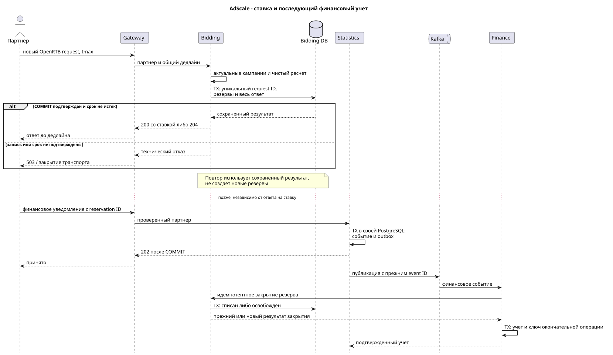
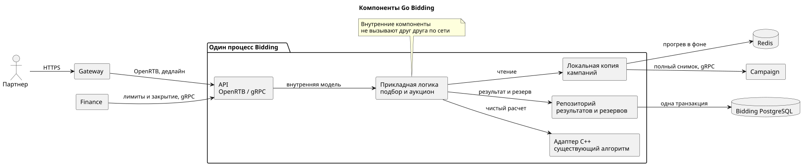

# Взаимодействия и время ответа

## Протоколы

| Связь | Выбор | Почему у нас нельзя проще |
|---|---|---|
| Партнер → Bidding | HTTPS, OpenRTB 2.6 JSON | Внешний контракт партнера |
| Bidding → Campaign/Finance | Фоновый gRPC, Protobuf | Типизированные контракты Go и загрузка снимков; REST также возможен, но второй внутренний стандарт не нужен |
| Statistics → Finance/Analytics | Kafka | Буферизация событий и независимая обработка; синхронные HTTP-вызовы связывают доступность сервисов |
| Bidding → собственная БД | PostgreSQL-транзакция | Результат и резервы фиксируются атомарно |

Синхронный путь ставки не вызывает Campaign, Finance и Kafka. Campaign обновляет подготовленные данные, Finance выдает лимиты, Statistics доставляет события независимо от ответа партнеру.

## Схемы

[Исходник sequence](diagrams/rtb-sequence.puml)

[Исходник component](diagrams/components.puml)

Внутри Bidding адаптер OpenRTB, прикладная логика, алгоритм аукциона и репозитории работают в одном процессе. Сетевое разделение этих частей добавляет задержки в RTB-путь.

## Бюджет 80 мс

| Участок | Плановый бюджет, мс |
|---|---|
| Сеть до AdScale и обратно | 20 |
| Gateway, прием и проверка | 5 |
| Поиск кампаний и аукцион | 20 |
| Сохранение результата и резервов | 15 |
| Формирование и отправка ответа | 5 |
| Запас | 15 |
| Итого | 80 |

Это предварительный бюджет, не результат измерения. В годовой схеме 15 мс для транзакции включают синхронную финансовую реплику другого региона; выбранную пару регионов нужно проверить под нагрузкой.

Gateway запускает общий таймер при приеме заголовков. Меньший `tmax` сокращает тот же срок; загрузка тела, очереди и соединение не открывают новое окно.

Внутренние операции получают оставшееся время, а перед COMMIT проверяется запас на возврат ответа. Просроченная ставка не отправляется. Тайм-аут Gateway не отменяет уже созданный резерв.

TCP/TLS-соединения переиспользуются. Повторы RTB на Gateway отключены: они расходуют дедлайн и создают неопределенность после записи.

## Проверка

Измерять полный ответ из точки партнера при 18 000 RPS, затем на годовом профиле 50 000 RPS. Отдельно проверять меньший `tmax`, медленное тело, перегрузку и задержку COMMIT.

Общий P95 платформы до 100 мс проверяется отдельно от предела партнера 80 мс. Сквозной P95 нельзя получить сложением P95 отдельных стадий.
