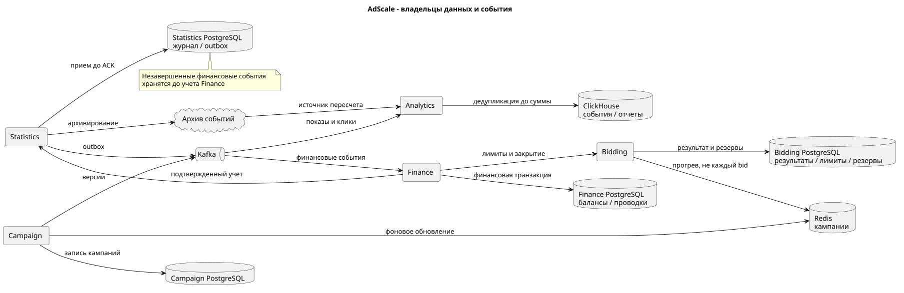

# Выбор хранилищ

Каждым набором данных владеет один сервис. Другие сервисы используют его API или события, а не подключаются к его таблицам.

## Database per Service

| Сервис | Хранилище | Обоснование | Почему у нас нельзя проще |
|---|---|---|---|
| Bidding | PostgreSQL | Атомарные результаты, лимиты и резервы | Redis не заменяет устойчивые транзакции |
| Campaign | PostgreSQL | Связанные кампании, настройки и версии | Отдельная документная БД не нужна |
| Statistics | PostgreSQL inbox/outbox | Устойчивый прием и повторная публикация | Прямая отправка в Kafka оставляет разрыв между HTTP-ответом и сохранением |
| Finance | PostgreSQL | Балансы, проводки, уникальные операции | Нужны транзакции и ограничения целостности |
| Analytics | ClickHouse | Большие выборки и агрегаты по времени | Read replica PostgreSQL подходит для перехода, но не для годовой аналитической нагрузки |

У сервисов отдельные логические БД, роли и миграции. Bidding и Finance физически изолированы от тяжелых отчетов. Database per Service не требует пяти отдельных серверов с первого дня.

Redis хранит восстановимый кеш, Kafka доставляет события. Объектное хранилище используется для материалов, архива событий и резервных копий.

## Согласованность

- результат запроса Bidding и все его резервы сохраняются одной транзакцией
- Finance атомарно записывает финансовый эффект и отметку обработки операции
- Campaign изменяет кампанию, версию и outbox в одной транзакции
- Statistics подтверждает прием только после сохранения события и outbox
- Analytics допускает задержку, но устраняет дубли до суммирования

Ключи и финансовые переходы определены в [Bidding](../Task2/bidding-service.md); обработка событий - в [Kafka](event-streaming.md).

## Переход и хранение

На первом этапе Campaign и Finance остаются в монолите за API. При последующем выделении переносятся снимок и изменения, сверяются ID и суммы, затем старому владельцу запрещается запись.

| Данные | Срок хранения |
|---|---|
| Результаты запросов и ключи повторов | Не менее 24 часов, дольше при незакрытом резерве |
| Необработанные финансовые события | До подтвержденного учета Finance, без автоматического удаления |
| Kafka | 7 суток |
| Архив событий | 90 суток |
| Сырые данные ClickHouse | 30 суток |
| Агрегаты отчетов | 12 месяцев |
| Финансовые записи и ключи окончательных операций | Без автоматического TTL, по учетной политике |

Архив не заменяет живой журнал незавершенных денежных операций. Удаление из Statistics допустимо после подтвержденной обработки Finance; истечение семи суток Kafka не снимает эту обязанность.

[Исходник](diagrams/data-flow.puml)
