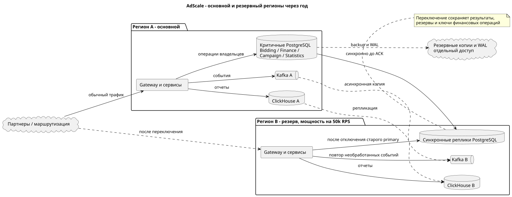

# Отказоустойчивость

На первом этапе приложения и синхронные реплики PostgreSQL размещаются в разных зонах одного региона. Годовая схема добавляет резервный регион с подготовленной мощностью на 50 000 RPS.

## Регионы и цели восстановления

[Исходник](diagrams/regions.puml)

RPO задает допустимую потерю данных, RTO - время восстановления работы. В таблице указаны целевые значения для отказа узла или одного региона.

| Данные | RPO | RTO через год | Механизм |
|---|---|---|---|
| Bidding | 0 для подтвержденных операций | До 2 минут | Синхронная PostgreSQL, результаты и резервы вместе |
| Finance | 0 для подтвержденных операций | До 2 минут | Синхронный журнал и ключи операций |
| Campaign | 0 для подтвержденных изменений | До 2 минут | Синхронная реплика, версии кампаний |
| Statistics | 0 для принятых финансовых событий | До 2 минут | Синхронный журнал до подтвержденного учета |
| Analytics | До 5 минут | До 1 часа | Реплика ClickHouse, повтор из журнала и архива |
| Redis | Допустима полная потеря | До 5 минут | Повторный прогрев из Campaign |

В годовой схеме критичные PostgreSQL подтверждают запись после синхронной копии в другом регионе. Это требует близкой пары регионов и проверки [бюджета 80 мс](../Task2/interaction.md).

Асинхронная копия не дает RPO=0. При сетевом разделении без подтвержденного единственного владельца новые денежные операции прекращаются.

## Переключение

1. Убрать нездоровый регион из маршрутизации.
2. Подтвердить отключение прежнего основного узла и продвинуть синхронную реплику.
3. Проверить лимиты, резервы, финансовые ключи и актуальность кампаний.
4. Восстановить доставку необработанных событий и постепенно открыть трафик.

Переключение не выдает бюджет заново и не создает второй результат запроса. При невозможности подтвердить целостность торги затронутого контура остаются закрыты.

После потери региона локальные синхронные копии сохраняют защиту от отказа узла. Гарантия второго регионального отказа возвращается только после восстановления межрегиональной копии.

## Резервные копии

PostgreSQL имеет ежедневную резервную копию и непрерывный архив WAL с хранением 35 суток. Копии шифруются и находятся отдельно от рабочего региона. ClickHouse копируется ежедневно; Kafka и Redis не считаются заменой backup.

Реплика не защищает от ошибочного удаления: для него нужна проверенная точка восстановления. После такого восстановления денежные операции блокируются до сверки, включая обязательства, возникшие после backup. Если полного источника для сверки нет, финансовая работа не возобновляется.

Раз в месяц копии восстанавливаются в изолированной среде. Проверяются данные, ключи повторов, резервы и возобновление доставки; время запуска БД измеряется отдельно от времени безопасного открытия торгов.

## 12 факторов

| Фактор | Применение |
|---|---|
| 1. Codebase | Версионированный исходный код каждого сервиса |
| 2. Dependencies | Зафиксированные Go/C++-зависимости и образы |
| 3. Config | Настройки в окружении, секреты в secret store |
| 4. Backing services | Адреса БД, Redis и Kafka задаются конфигурацией |
| 5. Build/release/run | Раздельные сборка, выпуск и запуск одного артефакта |
| 6. Processes | Состояние в хранилищах, экземпляры заменяемы |
| 7. Port binding | Сервис публикует HTTP/gRPC через собственный порт |
| 8. Concurrency | Горизонтальное добавление экземпляров |
| 9. Disposability | Проверка готовности, ограниченное завершение, сохранение outbox |
| 10. Dev/prod parity | Одинаковые версии зависимостей и схем окружений |
| 11. Logs | Структурированные логи в общий сборщик, без секретов |
| 12. Admin processes | Миграции и восстановление отдельными версионированными командами |

Эти принципы относятся к новым сервисам. Монолит приводится к ним постепенно, без требования переписать его целиком.
